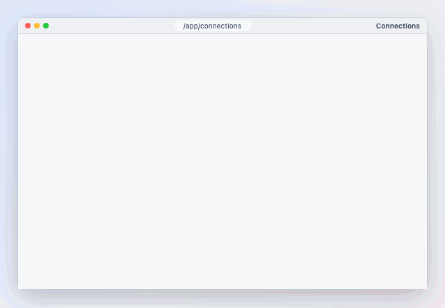
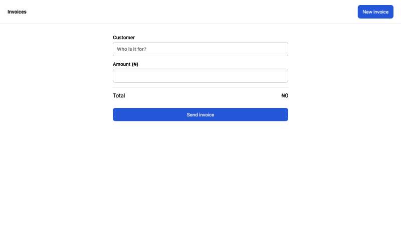

# trace-avatar

[](https://www.npmjs.com/package/trace-avatar)
[](https://github.com/saidiadegoke/trace-avatar/actions/workflows/ci.yml)
[](LICENSE)
[](https://github.com/saidiadegoke/trace-avatar)

**Show your users how, or do it for them.** One trace, two modes, on your real page:

- **Show me**: a smooth, human-looking ghost cursor walks through the steps over the page, with captions. It never
  touches the app. Docs, onboarding, demos, bug repros.
- **Do it for me**: the same cursor really clicks, types, picks options and submits, while the viewer watches.
  Demo accounts, sandbox set-up, "fill this in for me" helpers.

Element-anchored, so it survives layout changes. Zero dependencies. Record a trace by using your app.

| Show me | Do it for me |
|---|---|
|  |  |

<sub>Recorded on [DutyCaptain](https://dutycaptain.com) and [SpeedyMessaging](https://speedymessaging.com), HelloWorld Technologies products built with trace-avatar, on demo data; rendered with [trace-avatar-render](https://github.com/saidiadegoke/trace-avatar-render).</sub>

**Show me:**

```html
<script src="https://cdn.jsdelivr.net/npm/trace-avatar/dist/trace.min.js"></script>
<script>
  TraceAvatar.createTrace({
    trace: {
      version: 1,
      avatar: { name: 'Sarah · Sales' },
      steps: [
        { type: 'click', target: { role: 'button', name: 'New invoice' }, say: 'Start from New invoice.' },
        { type: 'type',  target: { role: 'textbox', name: 'Customer' }, text: 'Ada Stores' },
        { type: 'click', target: { text: 'Send invoice' }, say: 'Send it — done.' },
      ],
    },
    controls: true,
    autoplay: true,
  });
</script>
```

**Do it for me:** the `trace-perform` build acts on the page, and also plays Show me when you pass `mode: 'overlay'`.

```html
<script src="https://cdn.jsdelivr.net/npm/trace-avatar/dist/trace-perform.min.js"></script>
<button id="do-it">Do it for me</button>
<script>
  document.getElementById('do-it').onclick = () =>
    TraceAvatar.createTrace({ trace: '/tours/invoice.trace.json', controls: true, autoplay: true });
</script>
```

**[Try the playground →](https://saidiadegoke.github.io/trace-avatar/)**: edit a trace, record your own, and play it as
Show me or Do it for me.

Try it locally: `npm i && npm run build && npm run serve`, then open
`http://127.0.0.1:4173/examples/vanilla-html/` (switch between the two modes at the bottom left),
`/examples/guides-html/` (a whole app's guides from one script tag), or `/playground/`.

| | Show me (`mode: 'overlay'`) | Do it for me (`mode: 'perform'`) |
|---|---|---|
| Import | `trace-avatar` · `trace.min.js` | `trace-avatar/perform` · `trace-perform.min.js` |
| Touches the app | never: click-through overlay | clicks, types, presses keys, hovers |
| Typed text | shown in a chip | typed into the field (React/Vue/Svelte see it) |
| Masked fields | shown as `•••` | handed to the viewer: "Your turn: type in “Password”" |
| Viewer steps in | pauses; play resumes where it was | pauses; play resumes at the next `checkpoint` |
| Use it on | any page | sandbox or demo data |

Everything else is shared: the trace format, the recorder, captions, controls, pages and navigation, waits,
`prepare`, `resumeKey`, events, React and the custom element.

## Why it's different

- **Anchored to elements, not pixels.** Each step finds its element by CSS selector, then role + accessible name,
  then visible text, and only last by recorded pixels (scaled to the screen). A trace recorded on a 1440px laptop
  lands correctly on a 1280px one and in a 390px mobile layout.
- **Moves like a person.** Gentle curves at a human pace (seeded, so the same trace always moves the same way),
  or the real recorded pointer path re-anchored to today's page.
- **Lives on your live page.** The overlay is isolated in a shadow root and follows elements as the page or a panel
  scrolls. It brings each element into view, but never pulls back a viewer who has scrolled away to read on. Viewers can pause, take over, then resume the guide.
- **Does real work, safely.** Do it for me sets values the way frameworks notice, never learns a password (the viewer
  types masked fields), waits for the app (`until: { text: 'Saved' }`) instead of racing it, and survives full page
  loads.
- **Never fails silently.** A missing element makes the step wait with "Looking for “Save”…", then report `stalled`.
- **Accessible.** Respects `prefers-reduced-motion`, announces captions in an `aria-live` region, keyboard controls.

## Install

```bash
npm i trace-avatar
```

```js
import { createTrace } from 'trace-avatar';            // Show me

const guide = createTrace({ trace: '/tours/invoice.trace.json', controls: true });
guide.on('step', ({ index, element }) => console.log('step', index, element));
guide.on('stalled', ({ index, reason }) => console.warn('step', index, reason));
guide.play();
```

```js
import { createTrace } from 'trace-avatar/perform';    // Do it for me (mode: 'perform' is the default here)

const helper = createTrace({
  trace: '/tours/invoice.trace.json',
  navigate: (path) => router.push(path),                // go to the pages the trace needs
  prepare: async (requires) => requires.includes('signed-in') ? isSignedIn() : true,
  onReset: () => resetSandbox(),                        // before a restart
});
helper.on('handoff', ({ step }) => console.log('viewer types', step.target?.name));
helper.play();
```

### React

```jsx
import { TraceAvatar, useTrace } from 'trace-avatar/react';
import { createPerformer } from 'trace-avatar/perform';   // only for Do it for me

// Show me
<TraceAvatar trace={tour} autoplay controls onEnd={() => track('tour_done')} />

// Do it for me
<TraceAvatar trace={tour} mode="perform" performer={createPerformer} autoplay controls
             navigate={router.push} onHandoff={({ step }) => toast(`Your turn: ${step.target?.name}`)} />

// or drive it yourself
const guide = useTrace({ trace: tour, controls: true });
<button onClick={() => guide?.play()}>Show me how</button>
```

See [examples/react-demo/App.tsx](examples/react-demo/App.tsx) for a Show me / Do it for me switch.

### Any framework, or none: the custom element

```html
<script type="module" src="https://cdn.jsdelivr.net/npm/trace-avatar/dist/element.js"></script>
<trace-avatar src="/tours/invoice.trace.json" controls autoplay avatar-name="Sarah"></trace-avatar>
```

For Do it for me, add `mode="perform"` and give it hands (and any hooks) through the `hooks` property:

```js
import { createPerformer } from 'trace-avatar/perform';
document.querySelector('trace-avatar').hooks = { performer: createPerformer, navigate: (p) => router.push(p) };
```

Attributes: `src`, `controls`, `autoplay`, `rate`, `loop`, `captions`, `takeover`, `scroll`, `keyboard`, `avatar-name`, `avatar-image`, `avatar-color`,
`mode`, `resume-key`. Events: `trace-step`, `trace-stalled`, `trace-page`, `trace-handoff`, `trace-blocked`,
`trace-state`, `trace-end`, `trace-error`.

## Guides for your whole app: one script tag

```html
<script src="https://cdn.jsdelivr.net/npm/trace-avatar/dist/trace-auto.min.js"
        data-guides="/guides/index.json" data-perform="true" defer></script>

<button data-trace-guide="create-invoice">Show me how</button>
<button data-trace-guide="create-invoice" data-trace-mode="perform">Do it for me</button>
```

A small round button in the corner lists the guides for the page the viewer is on: "Show me · Do it for me". Any
element with `data-trace-guide="id"` starts one, including elements your framework renders later. While a guide
plays, the corner button becomes **Stop guide**. A guide carries on after a full page load. The player is fetched
on the first play, so until then the page pays about 5 KB.

`/guides/index.json` lists the guides (schema: `trace-avatar/guides.schema.json`):

```json
{
  "version": 1,
  "guides": [
    { "id": "create-invoice", "title": "Create an invoice", "trace": "create-invoice.trace.json",
      "modes": ["overlay", "perform"], "pages": ["/app/invoices", "/app"] }
  ]
}
```

| Script attribute | Default | |
|---|---|---|
| `data-guides` | — | the manifest URL (trace URLs in it are relative to it) |
| `data-launcher` | `bottom-right` | `bottom-left`, or `off` to hide the corner button and use your own buttons |
| `data-perform` | `false` | `true` allows Do it for me, for guides whose `modes` include `"perform"` (both must agree) |
| `data-links` | on | `overlay`: links play Show me only; `off`: links are ignored |

Without `pages` a guide is offered on every page. Only guides in the manifest can play, by id.

**Links.** `https://your.app/app/invoices?trace=create-invoice` opens the page and plays the guide; add
`&trace-mode=perform` for Do it for me (or use `#trace=…` if your server drops unknown parameters). The launcher has
**Copy link** on every guide, and `guides.link(id, { mode, path })` builds one.

- The parameter is removed from the address on arrival, so a reload doesn't replay it.
- If your `prepare` hook says the viewer must sign in first, the link waits through the sign-in (even a full page
  reload) for up to 10 minutes and plays once the guide can start.
- **A link can only name a guide id from your manifest**, never a trace or a trace URL, so nobody can put their
  own guide on your app by sending a link.
- **Do it for me from a link always asks first** ("Do it for me: Create an invoice — Start · Show me instead ·
  Cancel"). A link alone never makes your app act.

From npm, with your router and hooks:

```js
import { mount } from 'trace-avatar/auto';

const guides = mount({
  guides: '/guides/index.json',
  perform: true,
  navigate: (path) => router.push(path),
  prepare: async () => isSignedIn(),
  launcher: 'bottom-left',           // or false
});
guides.play('create-invoice', { mode: 'perform' });
guides.on('error', (e) => console.warn(e.message));   // unknown ids, refused modes, load failures
```

React: `<TraceGuides guides="/guides/index.json" perform navigate={router.push} />` from `trace-avatar/react`.
Custom element: `<trace-guides src="/guides/index.json" perform launcher="bottom-left">` from
`trace-avatar/element` (events `guides-ready`, `guides-play`, `guides-end`, `guides-stop`, `guides-error`).
Try it: `examples/guides-html/`.

**Record guides in the app (the studio).** Let the people you choose record guides where they work, with no JSON:

```js
mount({
  guides: '/guides/index.json',
  record: {
    allowed: () => user.role === 'owner',              // checked before the studio loads
    save: (trace, entry, { from }) => api.saveGuide(trace, entry, from), // default: a .trace.json download
    requires: ['signed-in'],
  },
});
```

"● Record a guide" appears in the launcher, `Alt+Shift+R` starts recording (`shortcut` changes it, `false` turns it
off) and so does `?trace-record=1`, all only when `allowed()` says yes. The studio (about 14 KB) is loaded then, never
before.

- **While recording**, a bar shows the time and the steps: **Pause**, **+ Caption** (on the last step), **Wait for…**
  (click an element: wait until it shows some text, or until it's gone, so Do it for me waits for your app), **Mask /
  Reveal** (click a field; passwords, card numbers and codes can never be revealed), **Stop**, and **⇅** to move
  the bar between the bottom and the top of the page. The recording carries
  on across full page loads and sign-ins.
- **After Stop**, a review panel lists the steps in words ("Click "Save"", "Wait for "Saved""): edit captions, move
  or delete steps, mark checkpoints and pauses, set the title, id, modes and pages. **▶ Show me** and **▶ Do it for
  me** test it right there (Do it for me can cross page loads). **Save** hands `save` the trace and its manifest
  entry; **Download** and **Copy JSON** are always there, and the raw JSON is under "Advanced".
- **To change a saved guide**, `guides.edit(id)` (or a `?trace-edit=id` link) opens it in the same review, again only
  when `allowed()` says yes. Its save gets `{ from: id }` as a third argument, and so does a save from **Fix this
  step**; a new recording gets `{}`. So your API can tell "replace this guide" from "a new guide whose id may already
  be taken".
- Saving is your app's job (your API, a CMS, a pull request); trace-avatar hosts nothing.

Without the loader: `import { createStudio } from 'trace-avatar/studio'` (CDN: `trace-studio.min.js`, global
`TraceAvatarStudio`), then `createStudio({ save }).start()`. The playground's Record button uses it.

## The trace format

A trace is plain JSON (`version: 1`). The schema ships at `trace-avatar/schema.json`.

```jsonc
{
  "version": 1,
  "meta": { "title": "Create an invoice", "viewport": { "w": 1440, "h": 900 }, "seed": 7 },
  "avatar": { "name": "Sarah · Sales", "image": "/sarah.png", "color": "#2456d8" },
  "steps": [
    { "type": "click", "target": { "sel": "[data-testid=new-invoice]" }, "say": "Start here." },
    { "type": "wait",  "target": { "sel": "#customer" }, "timeout": 5000 },
    { "type": "type",  "target": { "role": "textbox", "name": "Customer" }, "text": "Ada Stores" },
    { "type": "key",   "keys": "Mod+Enter", "say": "Save with ⌘↵." },
    { "type": "hover", "target": { "text": "Total" }, "hold": 1200, "pause": true }
  ]
}
```

| Step | Shows | Fields |
|---|---|---|
| `move` | cursor travels to the element | `target` |
| `click` / `dblclick` | travel, press, ripple, ring | `target` |
| `type` | travel, text appearing in a chip | `target`, `text`, `mask?`, `value?` |
| `upload` | travel, ring; Do it for me attaches the files | `target`, `files` |
| `key` | a shortcut chip (`⌘↵`, `Ctrl+Enter`) | `keys`, `target?` |
| `scroll` | scrolls the page or the element | `to` or `by`, `target?` |
| `hover` | travel, then stay | `target`, `hold?` |
| `wait` | holds until the element exists, or until a condition holds | `target`, `until?`, `timeout?` |
| `note` | a caption only | `say`, `hold?` |

Any step may carry `say` (caption), `highlight` (ring), `pause` (stop after this step), `t` (ms from start; omit it
and the step follows the previous one), `page` (the page it happens on, see below), and `checkpoint` (where perform mode resumes after the viewer steps in). Targets take any of `sel`, `role` + `name`, `text`, `xy`, plus `at: { rx, ry }`
to aim at a point inside the element. An optional `path` (`[[t, x, y], …]`) replays a real pointer path.

`validate(trace)` returns every problem with a path to it, and `createTrace` throws a `TraceError` for an invalid trace.

## Guides across pages

A step can name the page it happens on: `"page": "/app/tasks/new"`, with `*` for one path segment (`/app/tasks/*`).
Later steps keep that page until another step names one. The recorder fills it in for you, with record ids as `*`.

- On the wrong page the guide **doesn't search**, since a lookalike element on another page is not the one meant. It
  waits with "Open /app/tasks/new to continue" and carries on when the viewer gets there. It never gives up.
- Give it your router and it goes there itself: `createTrace({ trace, navigate: (path) => router.push(path) })`.
  Only pages without `*` are navigated to; the `page` event (`{ index, want, at }`) tells you about every one.
- If the viewer clicks through ahead of the guide, it catches up to the first later step on their page. It never
  skips its own start.
- Older traces without `page` play exactly as before.

## Waiting for the app

A `wait` step holds until its element exists. With `until` it holds until something has happened. It works in both
modes: Show me waits for the viewer's own click to take effect, Do it for me waits for its own.

```jsonc
{ "type": "wait", "until": { "text": "Saved" }, "say": "Saving…" }                       // the page shows "Saved"
{ "type": "wait", "target": { "sel": "#status" }, "until": { "text": "Running" } }        // that element does
{ "type": "wait", "target": { "sel": ".spinner" }, "until": { "gone": true }, "timeout": 60000 }  // it went away
```

The check runs at most every 250 ms, and only after the page has changed. It times out after `timeout` ms (default
5 s, at most 10 minutes) with a `stalled` event (`reason: 'until-timeout'`).

## Do it for me (perform mode)

```jsonc
{
  "version": 1,
  "meta": { "title": "Start a task", "requires": ["signed-in"] },
  "steps": [
    { "type": "click", "page": "/app", "target": { "role": "link", "name": "New task" } },
    { "type": "type",  "page": "/app/tasks/new", "target": { "role": "textbox", "name": "Objective" }, "text": "Check prices" },
    { "type": "type",  "target": { "role": "textbox", "name": "Budget code" }, "text": "•••", "mask": true },
    { "type": "click", "target": { "role": "button", "name": "Start task" }, "checkpoint": true },
    { "type": "wait",  "page": "/app", "target": { "sel": "#status" }, "until": { "text": "Running" }, "say": "Starting…" }
  ]
}
```

```js
import { createTrace } from 'trace-avatar/perform';   // CDN: trace-perform.min.js (TraceAvatar global)

createTrace({ trace, autoplay: true, navigate: (path) => router.push(path), prepare: () => isSignedIn() });
```

The same trace plays as Show me with `mode: 'overlay'` (or from `trace-avatar`). In Do it for me the guide really clicks, types, presses keys and hovers. Point it at **sandbox or demo data**: a trace can click
anything the page lets it.

- **Inputs:** values are set the way React, Vue and Svelte notice (native setter, then `input`); a select picks
  the option whose text you typed; rich-text editors get `insertText`; Enter in a form field submits the form.
- **It does what it can by default.** It types every value it knows, passwords and amounts included, and attaches
  every file the trace carries. Turn on `security` to hold some of that back (below).
- **Values at play time:** a recorded password is always masked, so a demo passes it when the guide plays:
  `values: { password: 'demo-pass' }`. A value is matched by the step's `value` name, its target's label, or the
  field's own name, id or label, in any case. It stands in even with security on: the host chose it.
- **Files:** an `upload` step's `files` with `url` (https:, relative or `data:`) or `text` are samples: Do it for
  me attaches them to the file input (the step's element, the input inside it or beside it) as a real pick would,
  so the app gets `input` and `change`. No picker opens.
- **The viewer's turn:** what it can't or may not do, it hands over: a masked field with no value, a file with no
  sample, a field security holds back, a frame (a payment form) it can't reach. The guide stops, focuses the field,
  rings it, shows a **Your turn** card ("Type in “Password”, then press Enter.") with a **Done** button, and emits
  `handoff` with `why` (`'masked'`, `'secret'`, `'money'`, `'file'`, `'no-file'`, `'frame'`). It carries on by
  itself when they press **Enter** (one-line fields; the form isn't sent) or **Tab** in the field, **choose a file**
  or an option, or press Done.
- **The viewer steps in:** real input pauses the guide. When they press play, it goes on from the next step marked
  `checkpoint: true`, since the page may have moved on. It never seeks backwards; restart starts over.
- **What it can't do:** browsers ignore synthetic events for fullscreen, the clipboard, payment and other
  cross-origin iframes. A step on a frame is the viewer's turn.

### Security

Default: nothing held back, since Do it for me is for demos and sandboxes. `security` limits it:

```js
createTrace({ trace, security: true });                  // all of the below
createTrace({ trace, security: ['secrets', 'money'] });  // or some
```

| Guard | Do it for me | Recording |
|---|---|---|
| `'secrets'` | passwords, card numbers and codes are the viewer's | (always masked, security or not) |
| `'money'` | amount and price fields are the viewer's | masked |
| `'files'` | no file is attached: the viewer chooses | no file content is kept |
| any guard | | typed text is masked unless a field is `data-trace-reveal` |

`values` still stand in. On the loader: `mount({ security })`, `data-security="secrets,money"` on the script tag,
`<trace-guides security>` / `<trace-avatar security>` (empty or `true` for all).

| Option | |
|---|---|
| `mode` | `'overlay'` (default in `trace-avatar`) or `'perform'` (default in `trace-avatar/perform`) |
| `prepare(requires, trace)` | runs before every start: sign into the sandbox, check the session. Return `true`, or `false` / `{ ok: false, say }` to show the message and stay put (`blocked` event); play tries again |
| `onReset()` | perform mode: put the app back before a restart |
| `resumeKey` | carry on after a full page load: the step is kept in `sessionStorage`, and a guide created with the same key on the next page (within 10 minutes) picks up from there |
| `performer` | the hands, for the main entry, React or the custom element: `performer: createPerformer` from `trace-avatar/perform` |
| `security` | what it leaves to the viewer: `true`, or `'secrets'`, `'money'`, `'files'` (see Security). Default none |
| `values` | values to type, by name or field label: `{ password: 'demo-pass' }` |

`meta.requires` (e.g. `["signed-in"]`) tells `prepare` what the guide needs; the recorder's `requires` option fills it
in. In React, pass `onHandoff` / `onBlocked`; on `<trace-avatar mode="perform" resume-key="…">`, set the `hooks`
property (`{ performer, prepare, onReset, navigate, currentPath, values }`) and listen for `trace-handoff` / `trace-blocked`.

## Options

| Option | Default | |
|---|---|---|
| `trace` | — | a trace object, or the URL of a `.trace.json` |
| `root` | `document` | where elements are looked up |
| `avatar` | trace's | `{ name, image, color }` override |
| `controls` | `false` | a small play/pause/step/speed/restart bar |
| `autoplay` | `false` | |
| `rate` | `1` | 0.25–4 |
| `loop` | `false` | |
| `captions` | `'bubble'` | `'bubble'`, `'bar'` or `'none'` |
| `takeover` | `'pause'` | what real viewer input does while playing: `'pause'` or `'ignore'` |
| `keyboard` | `false` | Space/K play-pause, ←/→ steps (outside form fields) |
| `scroll` | `'auto'` | may a step scroll the page to its element? `'auto'`: yes, until the viewer scrolls the page (wheel or touch); then not until they next play, pause or step. `'always'`, or `'never'` for a guide embedded in a page people read on. Authored `scroll` steps always scroll |
| `reducedMotion` | `'auto'` | follows `prefers-reduced-motion` |
| `seed` | trace's | changes the shape of authored paths |
| `navigate` | — | `(path) => void`: go to a page the trace needs (e.g. `router.push`); without it the guide waits |
| `currentPath` | `location.pathname` | where the viewer is, for apps that route without the address bar |
| `mode` | `'overlay'` | `'perform'` acts on the page (see Do it for me) |
| `prepare` / `onReset` / `resumeKey` | — | see Do it for me; `prepare` and `resumeKey` work in overlay mode too |
| `locators` | — | your own element finders, tried first: `(target, root, step) => Element \| null` |

Events (`on(name, fn)`): `step`, `stalled`, `page`, `handoff`, `blocked`, `state`, `end`, `error`.

Controller: `play()`, `pause()`, `toggle()`, `stop()`, `seek(ms)`, `next()`, `prev()`, `setRate(r)`, `on(event, fn)`,
`state`, `index`, `time`, `duration`, `trace`, `ready`, `destroy()`.

## Recording a trace

```js
import { createRecorder } from 'trace-avatar/record';   // or the CDN build: TraceAvatarRecord

const rec = createRecorder({ title: 'Create an invoice', avatar: { name: 'Sarah' } });
rec.start();
// … use the page …
const trace = rec.stop();   // a valid trace.json, or null if nothing happened
```

- Clicks, double-clicks, typing (one step per field), shortcuts (`Mod+K`, Enter, Esc, Tab), page and panel scrolls,
  and the pointer path (sampled at ~30 Hz, simplified, capped in memory).
- Pauses over 4 s play back as 1.5 s (`maxGapMs`, 0 keeps real time). Scrolls the player does anyway (it scrolls
  each target into view) are dropped; `scrolls: 'all'` keeps them.
- Each element is described by its most stable selector (`data-testid`, a human id, name, aria-label, then a short
  path), plus role + name, text and the pixel point, so it can be found again after the page changes. Addresses
  with record ids are skipped, a link in two places is scoped by its landmark (`nav a[href=…]`), a card is named by
  its title, and a field is never described by what was typed in it.
- The pixel point is the last resort: while a step's element is missing, the guide waits ("Looking for …"), so a
  viewer can click along through a multi-page app.
- **Typed text is kept; secrets never are.** Passwords, card, one-time-code and other secret fields are always
  masked. With `security` on, everything typed is masked unless a field is `data-trace-reveal`, and the `'money'`
  guard masks amounts whatever the default (`maskByDefault` sets the default yourself). `data-trace-ignore` hides
  anything from the recorder.
- **Files:** choosing a file records an `upload` step with each file's name, type and size, and its content as a
  `data:` URL when it is 256 KB or less (`keepFileBytes`; none under the `'files'` guard). When the input is hidden
  behind a button, the step is on the button that opened the picker.
- **Across page loads.** Give the recorder a `persistKey` (`createRecorder({ persistKey: 'app' })`) and create
  it on every page: a recording that was going on the last page carries on, in the same tab, for up to 30 minutes
  (`persistMs`). The page load itself counts as a pause. Coming back from another site (a sign-in) adds a pause step,
  "Sign in, then press play.", and `signed-in` to `meta.requires`. `rec.restored` tells you it carried on.
- For authors in your app, use the studio (above): it adds captions, waits and mask choices while recording, and a
  review panel after.
- The recorder's own API for tools: `caption(say)`, `waitFor(el, { text } | { gone: true })`, `mark(el, 'mask' |
  'reveal' | null)`, `elapsed`, `destroy({ keep: true })` (stop listening, keep the recording for the next page).

## AI suggestions (optional)

The studio can ask an AI for **captions**, **waits** (for the texts the app showed after a step, such as "Saved")
and **a title**. Each suggestion shows as before → after with Accept and Reject; nothing changes until the author
accepts. With no `ai`, nothing calls a model.

```js
mount({ guides: '/guides/index.json', record: { allowed, save, ai: (task, input, schema, o) =>
  fetch('/api/guide-ai', { method: 'POST', body: JSON.stringify({ task, input, schema, instructions: o.instructions }) }).then((r) => r.json()) } });
```

`ai` is any function returning JSON for the schema. In a page, make it call **your backend**; never put a model key in
a page. On the server (or anywhere a key is safe), `trace-avatar/assist` has two ready-made providers:

```js
import { suggest, apply, openAiCompatible, gemini, gateway } from 'trace-avatar/assist';
const ai = openAiCompatible({ baseUrl: 'https://api.deepseek.com', key: process.env.DEEPSEEK_API_KEY, model: 'deepseek-chat', visionModel: 'deepseek-flash' });
// any OpenAI-compatible server works: OpenAI, Ollama (http://localhost:11434/v1), OpenRouter, vLLM…
// Gemini's own API: gemini({ key, model: 'gemini-2.5-flash' })
// an AI gateway that forwards each provider's own calls: gateway({ url, key }) tries DeepSeek (usually the
// cheapest; deepseek-flash for images), then Gemini, then OpenAI. Or gateway({ provider: 'gemini', model }).
const { suggestions } = await suggest('captions', trace, { ai, tone: 'terse' });
const next = apply(trace, suggestions);   // or only the ones a person accepted
```

Failed calls are retried twice (a 429, a 5xx or no answer; following `Retry-After`). A gateway's own refusal, such
as a model not on the key's list, is not retried; the `AssistError` says which models are allowed and carries the
gateway's request id. `firstOf(a, b, …)` tries providers in turn for your own chains.

**What is sent:** step types, the role and accessible name of each step's element, page paths, existing captions
and timing; for waits, the short texts that appeared after each step. **Never:** what was typed (masked or not, unless
you pass `sendTyped: true`, and never a masked field's), selectors, or text inside fields, masked areas and
`[data-trace-blur]`. `preview(task, trace)` returns the exact payload; the studio shows it under "What's sent".
Answers are checked: a caption is at most 140 characters, a wait only uses a text the page really showed, and the
trace must stay valid, or the suggestion is left out. trace-avatar-render adds a visual check of rendered frames
(`--qa`) and alt text (`--alt`).

## Repairing a broken guide

When the app changes and a step can't find its element ("Looking for 'Save'…"), `trace-avatar/repair` lists what
the step could mean on the page now. `chooseRepair` (in `trace-avatar/assist`) picks one: code scores the
candidates first, and an AI is asked only when no candidate is a clear winner. The chosen element is re-recorded
the way the recorder does it, and checked with the player's own resolver. The fix is a suggestion that `apply()`
takes once a person agrees.

```js
import { candidatesOf, targetFor, resolvesTo, elementOf } from 'trace-avatar/repair';
import { chooseRepair, repairSuggestion, apply } from 'trace-avatar/assist';
const list = candidatesOf(document);                                   // [{ id, role, name, text, near }]
const choice = await chooseRepair(trace, stalledIndex, list, { ai });  // { id, by: 'score' | 'ai' | 'none', top }
const target = targetFor(choice.id);                                   // as if a person had just clicked it
if (resolvesTo(target, elementOf(choice.id))) next = apply(trace, [repairSuggestion(trace, stalledIndex, target)]);
```

A field's value is never read. Hidden, `[data-trace-ignore]` and `[data-trace-blur]` areas are never offered; a
masked field is offered by its label (a step may well mean the password box), never by what is in it. The AI gets the step, its neighbours and the best 30 candidates: no ids or test ids, and nothing that
contains a value typed in the guide. trace-avatar-render's `--repair` does all of this when a render stalls, and plays
the guide again to verify the fix.

**A wait whose text changed.** A guide recorded when the app said "Saved" stalls (`reason: 'until-timeout'`) once
the app says "Changes stored". `textsOf` lists the short texts (2 to 60 characters) where the wait looks (its
element, or the page), plus the texts that showed *while it waited*, which the stalled event carries as `seen`:
a message that came and went is still offered, marked `recent` and `gone`. Fields, buttons, links and other
controls, masked, ignored and blurred areas, and any text holding a value typed in the guide are never offered.
`chooseWait` scores them (texts that just showed count a little more) and asks an AI only when unsure; an AI's
answer must be one of the texts sent, or a part of one. `guessWait` is what to offer when nothing is sure.

```js
import { textsOf, scopeFor } from 'trace-avatar/repair';
import { chooseWait, guessWait, waitSuggestion, apply } from 'trace-avatar/assist';
const texts = textsOf(scopeFor(step.target), { seen: stalled.seen });     // [{ id, text, recent?, gone? }]
const best = guessWait(await chooseWait(trace, i, texts, { ai }), texts); // { id, text, guess } | null
if (best) next = apply(trace, [waitSuggestion(trace, i, best.text)]);      // until: { text: best.text }
```

### Fix this step, in the app

With `mount({ record: { allowed, save } })`, an author who meets a guide that can't find its element gets a card
where it stalled: **"Step 2 can't find button “Save invoice”." Fix this step · Stop**.

- **Fix this step** looks at the page and shows its best guess with a ring: **"Is it this? (button “Store invoice”)"
  Yes · No, I'll point at it · Cancel**. `record.ai` is asked only when the scores are unsure.
- **Pointing**: the next click picks the element and never reaches the app (presses are held back too); Esc goes
  back. A pick the player couldn't find again on its own is refused ("can't be told apart"), so a fix always works.
- The guide **carries on from that step** with the fixed trace, in the same mode. Then **Save the guide** hands the
  fixed trace and its manifest entry to `record.save` (or downloads `<id>.trace.json`), or **Just this time** keeps
  the fix for this session only.

A wait whose text never showed gets the same card: **"Step 3 waited for “Saved”, which never showed." Fix this
step · Remove this wait · Stop**. Fix this step asks **"Is it “Changes stored”?"** (adding "(seen while waiting)"
for a message that has gone), and pointing picks the text to wait for. Remove this wait drops the step, for an app
that no longer needs one; its caption moves on to the next step when that has none. A wait for something to go away
offers Remove and Stop only.

People who may not record see nothing new, and the fix code (`trace-avatar/fix`, CDN `trace-fix.min.js`, about 8 KB)
is loaded only when an author meets a stalled step.

## Theming

```css
:root {
  --ta-color: #2456d8;      /* cursor, ring, chips */
  --ta-badge-bg: #111827;   --ta-badge-fg: #f9fafb;
  --ta-caption-bg: #111827; --ta-caption-fg: #f9fafb;
  --ta-font: system-ui, sans-serif;
  --ta-z: 2147483000;
}
```

Dark-mode colours apply automatically unless you set your own.

## GIFs and videos of a guide

[trace-avatar-render](https://github.com/saidiadegoke/trace-avatar-render) plays a trace on your real app in
headless Chromium and writes a GIF or an MP4. Long waits (loading, saving) are cut, a stalled guide fails the
render (so a docs GIF that no longer matches the app fails CI), and masked fields only ever get dots.

```bash
npx trace-avatar-render invoice.trace.json --url http://localhost:3000/app --out invoice.gif
```

The GIFs at the top of this page are made that way from `examples/vanilla-html` (`?mode=off` loads it with no
guide running, for the renderer to bring its own). It can also put the app in a browser window, zoom in on each
action, burn in captions, and write VTT captions, a poster and title cards.

### Save as video, in the browser

No server needed: `trace-avatar/export` records the guide playing on the page itself. The browser asks to share
the tab, the guide plays from step 1, and you get a GIF or a video (WebM, or MP4 in Safari). Long waits are cut the
same way as the renderer cuts them.

```js
import { saveVideo } from 'trace-avatar/export';

const v = await saveVideo(controller, {
  format: 'gif',                              // or 'video'
  area: document.querySelector('#app'),       // what to keep; default the whole viewport
  onProgress: (p) => console.log(p.phase),    // 'asking' | 'recording' | 'encoding'
});
v.download();                                 // "send-an-invoice.gif", from the trace's title
```

Without a bundler: `<script src="https://unpkg.com/trace-avatar/dist/trace-export.min.js">` and
`TraceAvatarExport.saveVideo(controller, …)`. It rejects with an `ExportError` whose `reason` is `unsupported`,
`denied` (sharing refused), `cancelled` (sharing stopped, or `signal` aborted), `stalled` or `failed`. The GIF
encoder ([gifenc](https://github.com/mattdesl/gifenc), bundled) loads only for a GIF and runs in a worker; a page
whose Content-Security-Policy restricts workers needs `worker-src blob:`. A guide that changes pages with a full
page load can't be saved this way (the page doing the recording goes away); use trace-avatar-render for those. The
[playground](https://saidiadegoke.github.io/trace-avatar/playground/) has a "Save as video" button.

## What it does not do (yet)

- **Import rrweb recordings.** Planned.
- **Cross-origin iframes.** A page script cannot see into them.

## Size

About 15.5 KB min+brotli for the player (locators, overlay, controls, validation, pages, waits, the viewer's
turn); perform mode is a separate 18.5 KB entry (player + hands + security), the recorder a separate 10 KB one, the studio about 15.5 KB (loaded only for authors), the guides loader about
6 KB until its first play, Save as video 2.5 KB (plus 5 KB for the GIF encoder, loaded only for a GIF), repair 3.2 KB, and AI suggestions 3.8 KB in a page (5.5 KB with the server-side providers; the studio's Suggest section, 4.8 KB, loads only when opened). `size-limit` guards each in CI.

## Contributing

See [CONTRIBUTING.md](CONTRIBUTING.md). Every function and feature has a test: unit tests for the pure core and
Playwright tests on Chromium, Firefox and WebKit for the page. If this saves you time, a ⭐ helps others find it.

## License

MIT
